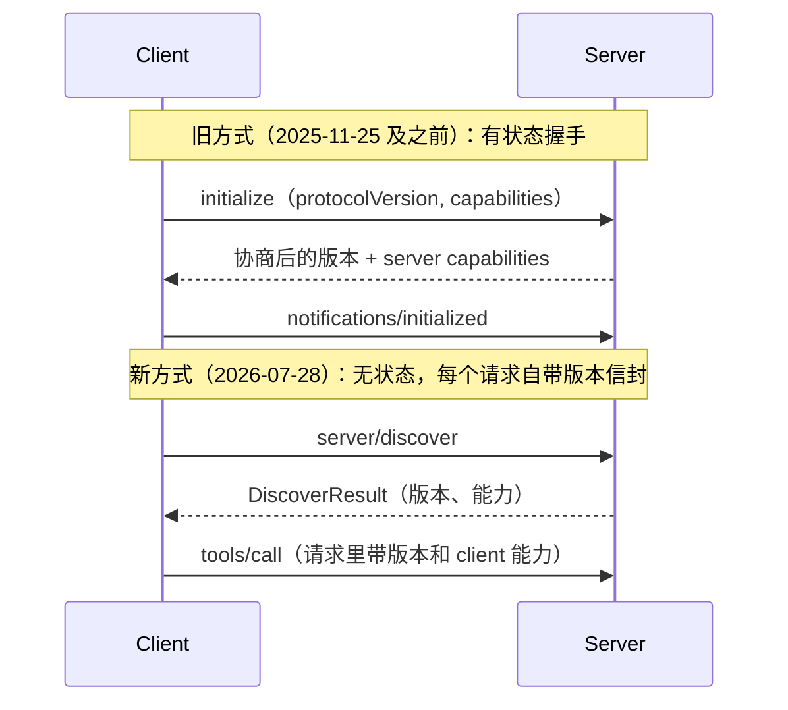

# Day 14 · MCP 协议：架构、transport、tools/resources/prompts、写一个 MCP server（2026-10-12）

> 本期核实方式说明：今天的运行环境无法打开网页正文（WebFetch 权限请求无人应答），所以**代码和版本相关的事实全部来自本机安装的官方包源码并实际跑通**：`mcp` 2.3.0（MCP 官方 Python SDK）、`fastmcp` 4.1.0、`langchain` 1.4.4、`anthropic` 1.13.0。概念部分是 MCP 规范里长期稳定的内容。参考资料里的网页链接是通过搜索确认存在的官方页面，建议你自己点开对照。

## 一句话总结

MCP（Model Context Protocol）是一个开放协议，用 JSON-RPC 2.0 把「AI 应用」和「外部能力」解耦：Server 暴露 **Tools（模型决定调用）、Resources（应用决定读取）、Prompts（用户选择触发）** 三种原语，Host 里的每个 Client 和一个 Server 保持一条连接，传输层可以是本地 **stdio** 或远程 **Streamable HTTP**。它解决的是 M 个应用 × N 个工具的 M×N 集成问题，变成 M+N。

## 核心概念

### 1. 为什么需要 MCP

Day 4/5 讲的 Function Calling 是**模型和你的代码之间**的约定；但工具本身写在哪、怎么被不同应用复用，没有标准。每个 Agent 框架都自己包一遍 GitHub、数据库、文件系统，就是 M×N。MCP 把「工具提供方」标准化成独立进程/服务，任何支持 MCP 的 Host（Claude Desktop、Claude Code、IDE、你自己的 LangChain Agent）都能直接接。

类比给 Android 开发者：**MCP 之于 Agent，类似 AIDL/Binder 之于 App 间能力调用**——有接口描述、有能力发现、有标准传输，但 MCP 是跨语言、跨进程甚至跨网络的。

### 2. 三个参与者

```
┌──────────────── Host（AI 应用：Claude Desktop / IDE / 你的 Agent）────────────────┐
│   LLM  ◄──►  Host 逻辑（权限、上下文拼装、UI）                                       │
│                 │                │                 │                               │
│            MCP Client A     MCP Client B      MCP Client C   ← 每个 Server 一个 Client │
└─────────────────┼────────────────┼─────────────────┼───────────────────────────────┘
                  │stdio           │stdio            │Streamable HTTP
            MCP Server A     MCP Server B       MCP Server C（远程）
            （文件系统）      （本地数据库）       （SaaS / 企业服务）
```

- **Host**：用户直接用的应用，管理多个 Client，负责安全策略和把结果塞进上下文。
- **Client**：Host 内部的连接器，和**一个** Server 一对一。
- **Server**：提供能力的程序，可以是本地子进程，也可以是远程服务。

### 3. 两层结构

| 层 | 内容 |
|---|---|
| 数据层（Data layer） | JSON-RPC 2.0 消息：生命周期/版本协商、原语（tools/resources/prompts…）、通知 |
| 传输层（Transport layer） | **stdio**：Host 把 Server 作为子进程启动，stdin/stdout 收发消息，适合本地；**Streamable HTTP**：HTTP POST 发请求，可选 SSE 流式返回，适合远程部署，支持标准 HTTP 认证（OAuth、Bearer token）。旧的 HTTP+SSE 双端点方式已被取代，SDK 仅为兼容保留 |

stdio 的一个**坑**：stdout 就是协议通道，Server 里随手 `print()` 会污染 JSON-RPC 消息，日志要写 stderr。

### 4. 原语：谁来控制，是面试必考点

| 原语 | 方向 | 控制方 | 典型方法 | 例子 |
|---|---|---|---|---|
| **Tools** | Server → | **模型**决定何时调用 | `tools/list`、`tools/call` | 开空调、查订单 |
| **Resources** | Server → | **应用**决定读什么 | `resources/list`、`resources/read`、URI 模板 | 车辆状态、文件内容 |
| **Prompts** | Server → | **用户**主动选择 | `prompts/list`、`prompts/get` | 斜杠命令「/出行检查」 |
| Sampling | ← Client | Server 请求 Host 帮它调 LLM | `sampling/createMessage` | Server 自己不持有模型 key |
| Elicitation | ← Client | Server 中途向用户要输入 | `elicitation/create` | 「确认删除吗？」 |
| Roots | ← Client | 告诉 Server 能碰哪些目录 | `roots/list` | 限定工作区 |

再加上**通知**：例如 `notifications/tools/list_changed`，Server 的工具列表变了，Client 重新拉取——这和 Day 13 讲的「工具列表变化会让 prompt cache 失效」直接相关。

### 5. 生命周期与版本（2026 年的新变化）



本机 SDK `mcp_types/version.py` 里登记的版本：`2024-11-05`、`2025-03-26`、`2025-06-18`、`2025-11-25` 属于 **initialize 握手时代**；`2026-07-28` 是 **stateless per-request envelope**（每个请求自带协议版本和客户端能力，HTTP 下还带 `mcp-protocol-version` / `mcp-method` / `mcp-name` 头）。SDK 的 `Client` 默认 `mode="auto"`：先探测 `server/discover`，老 Server 不支持就退回 initialize 握手。新版本还给 list 类方法加了可缓存提示（`ttlMs`/`cacheScope`，SEP-2549）。

面试里能讲清「为什么要去掉有状态会话」就加分：**有状态会话让远程 Server 难以水平扩容**（请求必须粘到同一实例），无状态后可以像普通 HTTP API 一样放在负载均衡后面。

### 6. 生态里的两个重要变化（写代码前必须知道）

1. **官方 Python SDK 2.x 把 `FastMCP` 改名为 `MCPServer`**：`from mcp.server.mcpserver import MCPServer`。老代码 `from mcp.server.fastmcp import FastMCP` 在 2.x 下会直接抛 `ModuleNotFoundError`，提示「pin `mcp<2`」或迁移。网上大量教程还是 v1 写法。
2. **LangChain 已经有原生 MCP 适配器 `langchain.mcp.MCPAdapter`（beta）**，底层用 FastMCP 客户端；旧的 `langchain-mcp-adapters`（`MultiServerMCPClient`）0.3.1 在 `mcp` 2.x 环境下我实测**导入就报错**（`cannot import name 'RequestContext'`），官方文档也有「Migrate from langchain-mcp-adapters」页面。

### 7. 在 Claude API 里直接用远程 MCP：MCP connector

不想自己写 Client，可以让 Claude API 直接连远程 MCP Server：请求里加 `mcp_servers=[{"type": "url", "name": "...", "url": "https://...", "authorization_token": "..."}]`，再在 `tools` 里放 `{"type": "mcp_toolset", "mcp_server_name": "..."}` 控制启用哪些工具。它是 beta 功能，只支持 `url` 类型（即远程 HTTP Server，不能连本地 stdio）。本机 SDK 里出现过的 beta 头有 `mcp-client-2025-04-04`、`mcp-client-2025-11-20`、`mcp-client-2026-09-15`，用哪个以当前文档为准。

## 代码示例

两段：一个最小「车机」MCP Server，加一个用 LangChain 原生适配器接入它的 Agent。均已在 `mcp 2.3.0 + fastmcp 4.1.0 + langchain 1.4.4` 下实测（`--dry` 模式不调用模型）。

```python
# car_server.py —— 一个最小的"车机" MCP server（stdio）
from mcp.server.mcpserver import MCPServer
from mcp.server.mcpserver.exceptions import ToolError

mcp = MCPServer("car")                       # server 名字，在握手/发现阶段告诉 client
_state = {"ac_temp": 24, "ac_on": False}     # 假装是车机状态

@mcp.tool()
def set_ac(on: bool, temp: int = 24) -> str:
    """打开/关闭空调并设置温度。temp 范围 16~30 摄氏度。"""
    if not 16 <= temp <= 30:
        raise ToolError("temp 必须在 16~30 之间")  # → isError=true，模型能看到原因
    _state.update(ac_on=on, ac_temp=temp)
    return f"空调已{'打开' if on else '关闭'}，{temp}°C"

@mcp.resource("car://status")
def status() -> str:
    """当前车辆状态（只读数据，由应用决定是否放进上下文）。"""
    return str(_state)

@mcp.prompt()
def trip_check(dest: str) -> str:
    """出行前检查模板（由用户选择触发）。"""
    return f"我要去{dest}，请先读取车辆状态，再给出出发前建议。"

if __name__ == "__main__":
    mcp.run()                                # 默认 transport="stdio"
```

```python
# agent.py —— 用 LangChain 原生 MCP 适配器把 MCP 工具接进 Agent
import asyncio, sys
from pathlib import Path
from langchain.agents import create_agent
from langchain.mcp import MCPAdapter          # beta 命名空间，导入时会有 BetaWarning

async def main():
    # Path 目标 = 以 stdio 子进程启动本地 server；http(s) URL 字符串 = Streamable HTTP
    async with MCPAdapter(Path("car_server.py")) as adapter:
        tools = await adapter.list_tools()      # tools/list → LangChain BaseTool
        print([t.name for t in tools])
        if "--dry" in sys.argv:                 # 不调模型，只验证工具链路
            print(await tools[0].ainvoke({"on": True, "temp": 40}))
            return
        agent = create_agent("anthropic:claude-sonnet-5-5", tools)
        out = await agent.ainvoke(
            {"messages": [{"role": "user", "content": "有点冷，空调开到 26 度"}]})
        print(out["messages"][-1].content)

asyncio.run(main())
```

**运行**：`pip install -U "mcp[cli]" fastmcp langchain langchain-anthropic`，两个文件放同一目录，先 `python agent.py --dry`（会打印 `['set_ac']` 和一条 temp 越界的错误），再设置 `ANTHROPIC_API_KEY` 后 `python agent.py`。调试 Server 本身可以用 `mcp dev car_server.py` 打开 MCP Inspector。

实测细节：如果 tool 里抛的是普通 `ValueError`，SDK 当作「崩溃」，模型只看到 `Error executing tool set_ac`，原因被吞掉；抛 `ToolError` 才会把你的消息带给模型。这正是 Day 5「工具错误要返回可操作信息」在 MCP 里的落地方式。

注意 `MCPAdapter` 只把 **tools** 转成 LangChain 工具；resources 和 prompts 要通过 `adapter.client` 自己读，这体现了「控制方不同」：资源是应用决定的，不该自动交给模型。

## 与 Android / 车载场景的联系

车机可以把「空调、座椅、导航、媒体」这类能力封装成一个 MCP Server（tools 管控制，resources 暴露车辆状态），语音助手作为 Host 接入；这样换模型、换 Agent 框架都不用改车控接口。真正上车时要考虑：高危操作（车窗、驾驶相关）用 Elicitation 或 Host 侧审批二次确认，本地 stdio 比远程 HTTP 更适合低延迟、离线的车控。

## 高频面试题

**1. MCP 是什么？和 Function Calling 是什么关系？**
- Function Calling 是模型 API 层面「模型输出结构化调用请求」的能力；MCP 是**工具如何被发现、描述、调用和传输**的应用层协议。
- 两者互补：Host 从 MCP Server 拉到工具定义 → 转成模型 API 的 tools 参数 → 模型发出 tool_use → Host 通过 MCP `tools/call` 执行 → 结果回填。
- 价值：解耦与复用，M×N → M+N。

**2. Tools、Resources、Prompts 有什么区别？为什么要分三种？**
- 核心是**控制方不同**：Tools 由模型决定调用（可能有副作用）；Resources 由应用决定读取（只读上下文数据，URI 寻址）；Prompts 由用户选择（模板/工作流入口）。
- 分开的好处：权限和 UX 设计更清楚。例如资源不会被模型随意触发，副作用操作集中在 tools，便于审批。

**3. stdio 和 Streamable HTTP 怎么选？**
- stdio：本地子进程，无网络开销，生命周期跟着 Host 走，适合本地文件/本地数据库/车机本地能力；注意不能往 stdout 打日志。
- Streamable HTTP：远程、多客户端共享、可走 OAuth，适合 SaaS 和企业内部服务；要做认证、限流、Origin 校验。
- 追问「SSE 呢？」：旧的 HTTP+SSE 传输已被 Streamable HTTP 取代，SSE 现在只是 Streamable HTTP 内部可选的流式返回方式。

**4.（追问）2026-07-28 版协议改成无状态，有什么影响？**
- 过去：`initialize` 握手后形成有状态会话，远程部署需要会话粘滞。
- 现在：`server/discover` 发现能力，每个请求自带版本和能力信封，Server 可以无状态水平扩展；list 类结果可以带缓存提示。
- 兼容：SDK `Client` 默认 auto 模式，先探测 discover，失败退回握手；面试时说明「新老 Server 共存期要做版本协商」。

**5.（场景题）公司想把内部 20 个业务系统接给 Agent，你用 MCP 怎么设计？**
- 按业务域拆 Server（订单、工单、知识库…），不要一个巨型 Server；每个 Server 的工具数控制住，描述写清楚（Day 5）。
- 远程用 Streamable HTTP + OAuth，按用户身份下传权限，Server 侧做最小权限和审计日志。
- 写操作返回结构化错误（`ToolError`/isError），高危操作走 Elicitation 或 Host 审批。
- 工具总数多时，Host 侧做工具筛选/按需加载（Claude API 的 `mcp_toolset` 可以按 server、按工具开关和 `defer_loading`），避免撑爆上下文（Day 13）。
- 安全：把 Server 返回内容当不可信输入，防间接 prompt injection（Day 23 详讲）。

**6. MCP Server 的安全风险有哪些？**
- 工具描述/返回内容中的提示注入；恶意或被篡改的第三方 Server（供应链）；过宽权限（如整个文件系统）；远程 Server 的认证与 token 透传问题。
- 对策：只装可信来源 Server、Roots 限定范围、敏感操作人审、Host 侧日志审计、不把用户 token 原样转发给下游。

## 常见误区

1. **以为 MCP 取代了 Function Calling**：MCP 不涉及模型怎么决定调用工具，最后还是要转成模型 API 的 tool 定义；它标准化的是「工具在哪、怎么连」。
2. **照抄 v1 教程写 `from mcp.server.fastmcp import FastMCP`**：在 `mcp` 2.x 下直接报错；同理 `langchain-mcp-adapters` 的老写法在新 SDK 下可能导入失败。面试时说清楚「我会先看 SDK 版本和迁移指南」比背代码更值钱。
3. **把所有东西都做成 Tool**：只读数据做成 Resource 更合适；工具越多，模型选错的概率和上下文开销越大。

## 手写练习（禁用 AI，约 20 分钟）

**今日片段：最小 MCP Server（tool + resource + prompt）**（20 行代码）

```python
# 导入官方 SDK 2.x 的高层 server 类
from mcp.server.mcpserver import MCPServer
# 导入"预期内的工具错误"，用它才能把错误原因带给模型
from mcp.server.mcpserver.exceptions import ToolError

# 创建一个名叫 car 的 server
mcp = MCPServer("car")
# 用一个字典模拟车机状态
_state = {"ac_temp": 24, "ac_on": False}

# 注册为工具：模型决定何时调用
@mcp.tool()
def set_ac(on: bool, temp: int = 24) -> str:
    """打开/关闭空调并设置温度。temp 范围 16~30 摄氏度。"""
    # 参数越界时抛预期错误，返回 isError=true
    if not 16 <= temp <= 30:
        raise ToolError("temp 必须在 16~30 之间")
    # 更新状态
    _state.update(ac_on=on, ac_temp=temp)
    # 返回给模型看的执行结果
    return f"空调已{'打开' if on else '关闭'}，{temp}°C"

# 注册为资源：用 URI 寻址，应用决定是否读取
@mcp.resource("car://status")
def status() -> str:
    """当前车辆状态。"""
    return str(_state)

# 注册为提示模板：用户主动选择
@mcp.prompt()
def trip_check(dest: str) -> str:
    """出行前检查模板。"""
    return f"我要去{dest}，请先读取车辆状态，再给出出发前建议。"

# 作为脚本运行时，用 stdio 传输启动
if __name__ == "__main__":
    mcp.run()
```

**三步走**
1. 看着上面的注释和代码，先手敲一遍全部注释，再手敲一遍代码（不复制粘贴）。
2. 不看任何东西，凭记忆手敲注释，再与原文核对。
3. 只看自己写的注释，手敲代码，再与原文核对。

**容易写错的地方**
- 装饰器要带括号：`@mcp.tool()`、`@mcp.resource("car://status")`、`@mcp.prompt()`；resource 必须传 URI。
- 导入路径是 `mcp.server.mcpserver`（2.x），不是 `mcp.server.fastmcp`（1.x）。
- 抛 `ToolError` 而不是 `ValueError`：后者模型只能看到 `Error executing tool set_ac`。另外 docstring 不能省，它就是给模型看的工具描述；类型注解就是 inputSchema。

**昨日复习（只做第③步）**：Day 13 的 `ask`（带预算检查和 prompt caching 的一轮对话）。只看你自己写过的注释，重写代码，重点核对 `count_tokens(...).input_tokens` 和顶层 `cache_control={"type": "ephemeral"}`。

## 动手练习（30 分钟）

给 `car_server.py` 加一个工具 `open_window(position: str, percent: int)`：`position` 只允许 `"front_left"/"front_right"/"rear_left"/"rear_right"`，`percent` 0~100，越界抛 `ToolError`；再加一个资源模板 `@mcp.resource("car://window/{position}")` 返回某个车窗开度。然后：
1. 用 `mcp dev car_server.py` 在 Inspector 里分别调用工具、读资源；
2. 用 `agent.py` 问「把副驾车窗开一半」，观察模型传的参数；
3. 思考：车速 > 80 km/h 时禁止开窗，这个检查应该放在 Server 里还是 Host 里？为什么？（提示：两边都要，但理由不同）

## 延伸学习

- Claude Academy：[Introduction to Model Context Protocol](https://academy.claude.com/courses/introduction-to-model-context-protocol)（旧地址 [anthropic.skilljar.com](https://anthropic.skilljar.com/introduction-to-model-context-protocol)）——从零写 MCP server/client，正好对应今天内容。
- Claude Academy：[Model Context Protocol: Advanced Topics](https://anthropic.skilljar.com/model-context-protocol-advanced-topics)——sampling、通知、transport 细节，适合第二轮复习。
- LangChain：[Model Context Protocol (MCP) - Docs by LangChain](https://docs.langchain.com/oss/javascript/langchain/mcp) 与 [Migrate from langchain-mcp-adapters](https://docs.langchain.com/oss/python/migrate/langchain-mcp-adapters)。

## 参考资料

本次实际阅读并运行过的官方源码（PyPI 官方包，版本见文首）：
- MCP Python SDK `mcp` 2.3.0：包内 README（`MCPServer`、`Client` 用法）、`mcp_types/version.py`（协议版本表）、`mcp/server/fastmcp.py`（改名说明）、`mcp/server/mcpserver/exceptions.py`（`ToolError` 语义）、`mcp/client/client.py`（`server/discover` 与 auto 模式）
- `langchain` 1.4.4：`langchain/mcp/adapter.py`（`MCPAdapter`）
- `langchain-mcp-adapters` 0.3.1：包内 README（`MultiServerMCPClient` 旧写法）
- `anthropic` 1.13.0：`types/beta/beta_mcp_toolset_param.py`、`beta_request_mcp_server_url_definition_param.py`

通过搜索确认存在、本次未能打开正文的官方页面（请自行对照）：
- [MCP Key Changes（2026-07-28 changelog）](https://modelcontextprotocol.io/specification/2026-07-28/changelog)
- [The 2026-07-28 MCP Specification Release Candidate](https://blog.modelcontextprotocol.io/posts/2026-07-28-release-candidate/)
- [MCP connector - Claude Platform Docs](https://platform.claude.com/docs/en/agents-and-tools/mcp-connector)
- [Connect to external tools with MCP - Claude Agent SDK](https://docs.claude.com/en/api/agent-sdk/mcp)
- [langchain-ai/langchain-mcp-adapters](https://github.com/langchain-ai/langchain-mcp-adapters)
- [Migrate from langchain-mcp-adapters - Docs by LangChain](https://docs.langchain.com/oss/python/migrate/langchain-mcp-adapters)
- [Introduction to Model Context Protocol · Claude Academy](https://academy.claude.com/courses/introduction-to-model-context-protocol)
