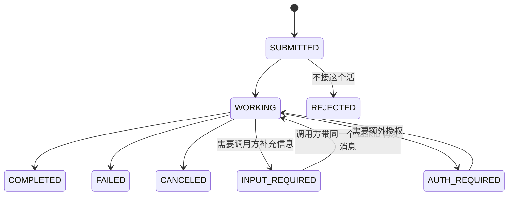

# Day 15 · Agent 间通信：A2A 协议、消息格式、能力发现、与 MCP 的区别（2026-10-13）

> **本期来源说明**：A2A 不是 LangChain 或 Claude 的协议，所以本篇的协议细节属于**「非 LangChain/Claude 来源」**。今天 a2a-protocol.org 的网页正文打不开（WebFetch 权限请求无人应答），所以协议字段、方法名、状态枚举都来自本机安装的官方 SDK `a2a-sdk` 1.2.2（a2aproject 官方 Python SDK，实现 A2A 规范 1.0，兼容 0.3）的源码和 protobuf 定义，代码也实际跑通了。LangChain 部分来自官方文档「A2A endpoint in Agent Server」，Claude 部分来自 Anthropic 工程博客，这两页本次都打开读过。

## 一句话总结

A2A（Agent2Agent）是一个让**独立部署、互相不透明的 Agent** 之间互相发现、委派任务的开放协议。每个 Agent 在 `/.well-known/agent-card.json` 发布一张 **Agent Card**（我是谁、会哪些 skill、怎么连、怎么鉴权），调用方通过 `SendMessage` 发 **Message**，对方返回一个有状态的 **Task**（submitted → working → completed / input-required…），结果放在 **Artifact** 里。和 MCP 的区别是：**MCP 是 Agent 调用工具（垂直），A2A 是 Agent 委托 Agent（水平）**。

## 核心概念

### 1. 为什么需要 Agent 间通信协议

Day 14 的 MCP 解决「一个 Agent 怎么接 N 个工具」。但企业里常见的情况是：财务部门有个报销 Agent，IT 有个工单 Agent，供应商还有个物流 Agent。它们由不同团队、用不同框架（LangGraph、Claude Agent SDK、自研）开发，部署在不同地方，**内部的 prompt、工具、记忆都不想暴露**。

如果把对方 Agent 包成一个 MCP tool 也能用，但会遇到几个问题：
- 工具调用默认是**一问一答、无状态**的。Agent 的任务可能跑几分钟甚至几小时，中途还要反问（「你要订哪天的？」）。
- 工具不会主动说「我需要你先登录授权」。
- 多轮协作需要一个**会话/任务 ID** 把上下文串起来。

A2A 把这些「Agent 级」的交互抽象成标准：**能力发现 + 有状态任务 + 多轮消息 + 流式/推送更新**。

### 2. 与 MCP 的区别：面试必考

```
                 ┌──────────── A2A（水平：Agent ↔ Agent，对方是黑盒）────────────┐
                 │                                                              │
          ┌──────▼──────┐   SendMessage / Task   ┌─────────────┐   A2A   ┌─────────────┐
用户 ───► │ 车机助手 Agent │ ─────────────────────► │ 行程规划 Agent │ ──────► │  酒店 Agent  │
          └──────┬──────┘                        └──────┬──────┘         └─────────────┘
                 │ MCP（垂直：Agent → 工具/数据）           │ MCP
          ┌──────▼──────┐                        ┌──────▼──────┐
          │ 车控 MCP Server│                        │ 地图 MCP Server│
          └─────────────┘                        └─────────────┘
```

| 维度 | MCP | A2A |
|---|---|---|
| 连接的两端 | Host（AI 应用）↔ 工具/数据提供方 | Agent ↔ Agent（client agent ↔ remote agent） |
| 对方是什么 | 能力清单透明的「工具」（有 inputSchema） | 不透明的「同事」：只公开 skill 描述，内部怎么做不暴露 |
| 交互单位 | `tools/call` 一次调用一个结果 | `Task`：有生命周期、可多轮、可取消、可长时间运行 |
| 能力发现 | `tools/list`、`resources/list` | Agent Card（`/.well-known/agent-card.json`）里的 `skills` |
| 输入 | 结构化参数（JSON Schema） | 自然语言为主的 `Message`，`Part` 可以是文本、文件、结构化数据 |
| 典型例子 | 读文件、查数据库、调空调 | 「帮我订下周去上海的酒店」交给另一个公司的 Agent |

两者**互补而不是替代**：一个 A2A Agent 内部通常用 MCP 接自己的工具。Anthropic 和 Google Cloud 合办的 webinar 也是把两者放在一起讲，定位为「工具集成、上下文共享、任务委派」。

### 3. 四个核心对象（以 A2A 1.0 / a2a-sdk 1.2.2 为准）

**① Agent Card：能力发现**

```json
{
  "name": "weather-agent",
  "description": "查询城市天气，给出出行建议",
  "version": "1.0.0",
  "supportedInterfaces": [{"url": "http://localhost:9999",
                           "protocolBinding": "JSONRPC", "protocolVersion": "1.0"}],
  "capabilities": {"streaming": true},
  "defaultInputModes": ["text/plain"], "defaultOutputModes": ["text/plain"],
  "skills": [{"id": "forecast", "name": "天气预报", "description": "输入城市名，返回天气",
              "tags": ["weather"], "examples": ["上海明天下雨吗"]}]
}
```

这是上面代码实际返回的 Card。SDK 里 `AgentCard` 的完整字段还有：`provider`、`documentationUrl`、`securitySchemes`（API Key / HTTP Bearer / OAuth2 / OpenID Connect / mTLS）、`securityRequirements`、`signatures`（对 Card 做签名，防止被篡改）、`iconUrl`。`capabilities` 里有 `streaming`、`pushNotifications`、`extensions`、`extendedAgentCard`（鉴权后可以拿到一张更详细的 Card，对应 `GetExtendedAgentCard` 方法）。

发现方式：公开 Agent 用约定的 well-known 路径；企业内部常见的是**注册中心**（把 Card 集中登记，按 skill/tag 检索）。这一点跟 Android 的 `PackageManager.queryIntentActivities()` 很像：先按「能干什么」查，再决定交给谁。

**② Message 与 Part：消息格式**

- `Message`：`messageId`、`contextId`、`taskId`、`role`（`ROLE_USER` / `ROLE_AGENT`）、`parts`、`metadata`、`referenceTaskIds`（引用之前的任务）。
- `Part`：1.0 里把旧版的 `TextPart / FilePart / DataPart` 合并成**一个 Part**，用字段区分：`text`、`raw`（字节）、`url`（文件链接）、`data`（任意结构化 JSON），再加上 `filename`、`mediaType`。

**③ Task：有状态的工作单元**



1.0 的枚举名是 `TASK_STATE_SUBMITTED / WORKING / COMPLETED / FAILED / CANCELED / INPUT_REQUIRED / REJECTED / AUTH_REQUIRED`。0.3 时代是小写短横线写法，比如 `input-required`。

`contextId` 把多个 Task 串成一次会话，`taskId` 标识一次具体任务。

**④ Artifact：任务产出物**

Task 的结果不放在聊天消息里，而是放在 `artifacts`（`artifactId`、`name`、`parts`）。「过程中的对话」和「最终交付物」分开存放，调用方可以只取产出物，不用解析整段对话。

### 4. 方法与传输

| 1.0 方法名 | 0.3 方法名 | 作用 |
|---|---|---|
| `SendMessage` | `message/send` | 发消息，返回 Task 或直接返回 Message |
| `SendStreamingMessage` | `message/stream` | 同上，用 SSE 流式返回状态和产出物更新 |
| `GetTask` / `ListTasks` | `tasks/get` / — | 查询任务（轮询） |
| `CancelTask` | `tasks/cancel` | 取消 |
| `SubscribeToTask` | `tasks/resubscribe` | 断线后重新订阅任务流 |
| `Create/Get/List/DeleteTaskPushNotificationConfig` | — | 注册 webhook，长任务完成后由服务端推送 |
| `GetExtendedAgentCard` | — | 鉴权后获取扩展版 Card |

1.0 的方法名和 gRPC service 的方法名一致。传输绑定有三种：**JSON-RPC 2.0**、**HTTP+JSON（REST）**、**gRPC**。请求头 `A2A-Version` 用来声明协议版本。

拿到结果的三种方式要能说清楚：**同步等待**（短任务）、**SSE 流式**（需要实时进度）、**Push Notification webhook**（小时级任务，调用方不想一直挂着连接）。这跟 Android 里「同步调用 / Flow 收集 / FCM 推送」的选择逻辑类似。

### 5. LangChain 怎么支持 A2A

LangSmith Deployment 的 **Agent Server** 自带 A2A 端点（官方文档「A2A endpoint in Agent Server」）：

- 每个 assistant 自动暴露在 `/a2a/{assistant_id}`，Agent Card 在 `/.well-known/agent-card.json?assistant_id=...`。
- 实现的是 A2A **v1.0 JSON-RPC 绑定**，同时接受 4 个 v0.3 方法名。gRPC 和 HTTP+JSON 还没有实现。
- **要求图的 state 里有 `messages` 键**，否则拒绝。
- **`contextId` 直接当作 LangGraph 的 `thread_id` 使用**，所以必须是 UUID。传 `session-42` 这种值会返回 `-32602`。第一次调用时不传 contextId，由服务端生成；后续多轮只传 contextId，每一轮都是同一 context 下的一个新 task。
- 支持 `SendMessage / SendStreamingMessage / GetTask / CancelTask / ListTasks / GetExtendedAgentCard`。`SubscribeToTask` 和推送配置目前返回 `-32601`。
- 需要 `langgraph-api >= 0.4.21`。可以在 `langgraph.json` 里设置 `{"http": {"disable_a2a": true}}` 关掉。

结论：**用 LangGraph 写的 Agent，部署到 Agent Server 就自动成为 A2A Agent**，不需要自己写协议层。

### 6. Claude 这边的视角：进程内多 Agent 通信的经验

Claude 官方没有把 A2A 作为自己的协议，但 Anthropic 工程博客《How we built our multi-agent research system》讲了 **lead agent ↔ subagent 之间怎么传信息**，这些经验对任何 Agent 间通信都适用：

- **委派任务时要写清楚任务说明**：目标、期望的输出格式、可以用哪些工具和来源、任务边界。早期说明写得太模糊时，subagent 会误解任务，或者和别的 subagent 做重复搜索。
- **避免「传话游戏」**：subagent 把大块产出写到外部存储，只把**轻量引用**传回协调者，这样既减少信息在层层转述中丢失，也省 token。这和 A2A 把结果放在 Artifact、通过 `url` Part 传文件引用是同一个思路。
- **同步执行是瓶颈**：他们的 lead agent 同步等待 subagent，没法在中途调整方向，一个慢的 subagent 会拖住整体。改成异步可以提高并行度，但会带来结果协调、状态一致性、错误处理上的难题。这正是 A2A 设计成「有状态 Task + 流式/推送」的原因。
- **代价**：多 Agent 系统大约消耗普通对话 15 倍的 token，只适合价值高的任务。

## 代码示例

一个最小 A2A Server 加一个**不用 SDK、直接发 HTTP 请求**的客户端，让你看到线上传输的原始消息格式。已在 `a2a-sdk 1.2.2` 下实测通过。

```python
# weather_agent.py —— 最小 A2A Server（a2a-sdk 1.2.2，A2A 规范 1.0，JSON-RPC 绑定）
import uvicorn
from starlette.applications import Starlette
from a2a.types import AgentCard, AgentCapabilities, AgentInterface, AgentSkill
from a2a.server.agent_execution import AgentExecutor, RequestContext
from a2a.server.events import EventQueue
from a2a.server.request_handlers import DefaultRequestHandler
from a2a.server.tasks import InMemoryTaskStore, TaskUpdater
from a2a.server.routes import create_agent_card_routes, create_jsonrpc_routes
from a2a.helpers import new_task_from_user_message, new_text_part, get_message_text

card = AgentCard(  # Agent Card：能力发现用的"名片"，挂在 /.well-known/agent-card.json
    name="weather-agent", description="查询城市天气，给出出行建议", version="1.0.0",
    supported_interfaces=[AgentInterface(url="http://localhost:9999",
                                         protocol_binding="JSONRPC", protocol_version="1.0")],
    capabilities=AgentCapabilities(streaming=True),
    default_input_modes=["text/plain"], default_output_modes=["text/plain"],
    skills=[AgentSkill(id="forecast", name="天气预报", description="输入城市名，返回天气",
                       tags=["weather"], examples=["上海明天下雨吗"])])

class WeatherExecutor(AgentExecutor):
    async def execute(self, context: RequestContext, event_queue: EventQueue):
        task = context.current_task or new_task_from_user_message(context.message)
        await event_queue.enqueue_event(task)                 # 先登记 Task（SUBMITTED）
        up = TaskUpdater(event_queue, task.id, task.context_id)
        await up.start_work()                                 # → WORKING
        city = get_message_text(context.message).strip()
        if not city:                                          # 信息不够 → 反问调用方
            await up.requires_input(up.new_agent_message([new_text_part("请告诉我城市名")]))
            return
        await up.add_artifact([new_text_part(f"{city}：多云 22°C，适合出行")], name="forecast")
        await up.complete()                                   # → COMPLETED

    async def cancel(self, context: RequestContext, event_queue: EventQueue):
        await TaskUpdater(event_queue, context.task_id, context.context_id).cancel()

handler = DefaultRequestHandler(agent_executor=WeatherExecutor(),
                                task_store=InMemoryTaskStore(), agent_card=card)
app = Starlette(routes=create_agent_card_routes(card) + create_jsonrpc_routes(handler, "/"))
if __name__ == "__main__":
    uvicorn.run(app, port=9999)
```

```python
# client.py —— 不用 SDK，裸 HTTP 走一遍：发现 → 委派 → 查任务
import uuid, httpx
card = httpx.get("http://localhost:9999/.well-known/agent-card.json").json()
print("技能:", [s["name"] for s in card["skills"]])
url = card["supportedInterfaces"][0]["url"]

def rpc(method, params):  # JSON-RPC 2.0 信封；A2A-Version 头声明协议版本
    body = {"jsonrpc": "2.0", "id": str(uuid.uuid4()), "method": method, "params": params}
    r = httpx.post(url, json=body, headers={"A2A-Version": "1.0"}).json()
    if "error" in r: raise RuntimeError(r["error"])
    return r["result"]

msg = {"messageId": str(uuid.uuid4()), "role": "ROLE_USER", "parts": [{"text": "上海"}]}
task = rpc("SendMessage", {"message": msg})["task"]
print(task["status"]["state"], task["artifacts"][0]["parts"][0]["text"])
print("GetTask:", rpc("GetTask", {"id": task["id"]})["status"]["state"])
```

**运行**：`pip install "a2a-sdk[http-server]" httpx uvicorn`。先运行 `python weather_agent.py`，再在另一个终端运行 `python client.py`。实测输出依次为：`技能: ['天气预报']`、`TASK_STATE_COMPLETED 上海：多云 22°C，适合出行`、`GetTask: TASK_STATE_COMPLETED`。

实测中的三个细节：
1. 把 `"上海"` 换成 `" "`，返回的状态是 `TASK_STATE_INPUT_REQUIRED`，`status.message` 里带着「请告诉我城市名」。这就是 A2A 多轮交互的入口。
2. 用 0.3 的方法名 `message/send` 调用这个 Server，会返回 `-32601 Method not found`。Server 端要在 `create_jsonrpc_routes(..., enable_v0_3_compat=True)` 里打开兼容模式才认旧方法名。新旧版本共存是现在接入 A2A 最常见的坑。
3. 这里的 Executor 没有接模型。实际项目中，`execute` 里可以调用 LangGraph 图或 Claude，A2A 只负责外层的协议。

## 与 Android / 车载场景的联系

车机助手作为「client agent」，可以通过 A2A 把「订酒店、订充电桩、查违章」委派给车企云端或第三方服务商的 Agent，对方不需要暴露内部实现。车内本地车控仍然用 MCP 或 AIDL。长任务（比如「到了充电站自动排队」）适合用 Push Notification，不要让车机一直保持 SSE 长连接，弱网环境下扛不住。

## 高频面试题

**1. A2A 和 MCP 有什么区别？能不能只用一个？**
- MCP：Agent → 工具/数据，对方是透明的能力（schema 明确），一次调用对应一个结果。
- A2A：Agent → Agent，对方是不透明的自治体，交互单位是有生命周期的 Task，支持多轮、反问、长时间运行、取消。
- 互补关系：A2A Agent 内部用 MCP 接工具。只用 MCP 也能把远程 Agent 包成 tool，但会失去任务状态、`input-required` 多轮交互、流式和推送这些能力，还得自己补上。

**2. A2A 里的「能力发现」怎么做？Agent Card 里有什么？**
- Card 发布在 `/.well-known/agent-card.json`，内容包括名称、描述、版本、`supportedInterfaces`（URL + 绑定 + 协议版本）、`capabilities`（streaming / pushNotifications / extensions）、`skills`（id、描述、tags、examples、输入输出模式）、`securitySchemes`。
- Client Agent 的 LLM 会读 skill 描述来决定委派给谁。所以 skill 描述要像 Day 5 的工具描述那样写清楚。
- 企业内部通常还会有注册中心；对 Card 可以做签名校验，鉴权后还能拿到扩展版 Card。

**3.（追问）一个 Task 要跑 2 小时，调用方怎么拿结果？三种方式各适合什么场景？**
- 同步 `SendMessage`：只适合秒级任务。也可以让服务端立即返回 Task，之后用 `GetTask` 轮询。
- `SendStreamingMessage`（SSE）：需要实时进度、并且连接稳定时使用；断线后用 `SubscribeToTask` 重新订阅。
- Push Notification（webhook）：小时级任务、移动端或弱网环境。服务端要校验回调 URL（防 SSRF），回调请求要带鉴权信息，调用方要做幂等处理（推送可能重复送达）。

**4.（追问）`contextId` 和 `taskId` 有什么区别？在 LangGraph 里分别对应什么？**
- `contextId` 是会话，可以包含多个 Task；`taskId` 是一次具体的工作。补充信息（回应 `INPUT_REQUIRED`）时要带上原来的 taskId；开始一个新请求时只带 contextId。
- LangChain Agent Server 把 `contextId` 直接当作 LangGraph `thread_id`（必须是 UUID），也就是 checkpoint 的维度。向已经完成的 task 再发消息会返回 `-32004`。

**5.（场景题）公司要让客服 Agent 调用财务部门的退款 Agent 和物流部门的查件 Agent，三个团队技术栈不同。你怎么设计？**
- 每个部门的 Agent 独立部署，对外只暴露 A2A（Card + JSON-RPC），内部各自用 MCP 接自己的系统。
- 发现：内部注册中心登记 Card，客服 Agent 按 skill 检索；Card 做签名校验。
- 安全：用 OAuth2 client credentials 做服务间鉴权，用户身份通过 token 交换往下游传递，不直接透传原始用户 token。退款这类高风险操作由财务 Agent 返回 `AUTH_REQUIRED` 或 `INPUT_REQUIRED`，触发人工确认。
- 可靠性：退款请求带幂等键（放在 metadata 里），设置超时和取消（`CancelTask`），长任务用推送。
- 可观测性：把 contextId 作为全链路 trace ID（LangSmith 就是按它归组 trace 的）。
- 防注入：对方返回的内容都当作不可信输入，不能让下游 Agent 返回的文本直接变成上游的指令。

**6. 多 Agent 之间传大结果（比如一份 50 页报告），怎么避免上下文爆炸和信息失真？**
- 不要把全文放在消息里层层转述。产出物放到外部存储，只传引用（A2A 的 Artifact，`url` 类型的 Part）。Anthropic 的多 Agent 研究系统就是让 subagent 写外部存储、只回传轻量引用，以减少「传话游戏」造成的信息丢失。
- 协调者只读摘要和引用，需要细节时再按需读取（呼应 Day 13 的上下文隔离）。

## 常见误区

1. **「A2A 是用来替代 MCP 的」**：两者解决的是不同层面的问题，生产系统里通常同时使用。面试时说「互补」，再画出上面那张水平/垂直的图。
2. **照着旧教程写 0.3 的格式**：`message/send`、`"kind": "text"`、小写的 `completed`，在只支持 1.0 的 Server 上会直接返回 `-32601`。LangChain 文档还提到，同一个 Server 上响应格式取决于你用的方法名属于哪个版本，所以一个客户端只能用一套方法名。动手前先看对方 Card 里的 `protocolVersion`。
3. **把对方 Agent 的回复当成可信指令**：对方是黑盒，也可能被注入了恶意内容。它返回的文本应该当作数据来处理，高风险动作要在自己这边再校验一次。

## 手写练习（禁用 AI，约 20 分钟）

**今日片段：A2A AgentExecutor 的 Task 生命周期**（16 行代码）

```python
# 定义执行器：A2A 框架收到消息后会调用它
class WeatherExecutor(AgentExecutor):
    # 处理一次请求，结果通过事件队列发出去
    async def execute(self, context: RequestContext, event_queue: EventQueue):
        # 如果是续接已有任务就用它，否则根据用户消息新建一个任务
        task = context.current_task or new_task_from_user_message(context.message)
        # 先把任务登记出去，状态为 SUBMITTED
        await event_queue.enqueue_event(task)
        # 创建状态更新助手，绑定任务 id 和会话 id
        up = TaskUpdater(event_queue, task.id, task.context_id)
        # 状态切换为 WORKING
        await up.start_work()
        # 取出用户消息里的文本
        city = get_message_text(context.message).strip()
        # 信息不足时把状态设为 INPUT_REQUIRED，并反问调用方
        if not city:
            await up.requires_input(up.new_agent_message([new_text_part("请告诉我城市名")]))
            # 交出控制权，等对方补充信息后再被调用
            return
        # 把结果作为产出物挂到任务上
        await up.add_artifact([new_text_part(f"{city}：多云 22°C，适合出行")], name="forecast")
        # 状态切换为 COMPLETED
        await up.complete()

    # 取消任务：把状态设为 CANCELED
    async def cancel(self, context: RequestContext, event_queue: EventQueue):
        await TaskUpdater(event_queue, context.task_id, context.context_id).cancel()
```

**三步走**
1. 看着上面的注释和代码，先手敲一遍全部注释，再手敲一遍代码（禁止复制粘贴）。
2. 不看任何东西，凭记忆手敲注释，再与原文核对。
3. 只看自己写的注释，手敲代码，再与原文核对。

**容易写错的地方**
- `TaskUpdater(event_queue, task.id, task.context_id)` 的参数顺序是「队列、任务 id、会话 id」，不要漏掉 `context_id`。
- 要先 `enqueue_event(task)` 登记任务，再去更新状态；`requires_input` 之后要 `return`，否则代码会继续往下走到 `complete()`。
- `cancel` 是抽象方法，必须实现；它从 `context.task_id` / `context.context_id` 取 id，不是从 `task` 变量取。

**昨日复习（只做第③步）**：Day 14 的「最小 MCP Server（tool + resource + prompt）」。只看你自己写过的注释，重写代码，重点核对导入路径 `mcp.server.mcpserver`、三个装饰器都带括号，以及抛 `ToolError` 而不是 `ValueError`。

## 动手练习（30 分钟）

把今天的 weather-agent 改成**两轮对话**：
1. 客户端第一次发送 `" "`，拿到 `TASK_STATE_INPUT_REQUIRED`，记下返回的 `task.id` 和 `contextId`。
2. 第二次发送 `{"messageId": 新 uuid, "role": "ROLE_USER", "taskId": 上一步的 id, "contextId": 上一步的 contextId, "parts": [{"text": "杭州"}]}`，确认最终状态变为 `COMPLETED`，并且两次的 `task.id` 相同。
3. 再试一次：不带 `taskId`、只带 `contextId` 发送「北京」，观察是不是产生了一个新的 task id。说明 context 和 task 的区别。
4. 思考：如果要让车机助手（client agent）用 Claude 自动选择委派给哪个 A2A Agent，你会怎么把 Card 里的 `skills` 转成给模型看的 tool 描述？

## 延伸学习

- LangChain：[A2A endpoint in Agent Server](https://docs.langchain.com/langsmith/server-a2a)，讲怎么把 LangGraph Agent 直接部署成 A2A Agent，以及 contextId 和 thread_id 的映射。
- Anthropic × Google Cloud webinar：[Deploying multi-agent systems using MCP and A2A with Claude on Vertex AI](https://www.anthropic.com/webinars/deploying-multi-agent-systems-using-mcp-and-a2a-with-claude-on-vertex-ai)。
- Claude Academy：[Introduction to subagents](https://academy.claude.com/courses/introduction-to-subagents)，讲进程内的 Agent 间协作，明天 Day 16 多智能体架构会用到。

## 参考资料

本次实际打开阅读的官方页面：
- [A2A endpoint in Agent Server - Docs by LangChain](https://docs.langchain.com/langsmith/server-a2a)
- [How we built our multi-agent research system - Anthropic](https://www.anthropic.com/engineering/multi-agent-research-system)
- [Deploying multi-agent systems using MCP and A2A with Claude on Vertex AI - Anthropic](https://www.anthropic.com/webinars/deploying-multi-agent-systems-using-mcp-and-a2a-with-claude-on-vertex-ai)

本次实际阅读并运行过的源码（非 LangChain/Claude 来源）：
- `a2a-sdk` 1.2.2（PyPI，a2aproject 官方 Python SDK）：包内 README（规范版本与兼容性表）、`a2a/types/a2a_pb2.pyi`（AgentCard、Message、Part、Task、TaskState 定义）、`a2a/server/agent_execution/agent_executor.py`（执行器契约）、`a2a/server/routes/jsonrpc_dispatcher.py`（1.0 方法名表）、`a2a/utils/constants.py`（well-known 路径、`A2A-Version` 头）

通过 SDK README 确认存在、本次未能打开正文的规范页面（建议自己对照阅读，非 LangChain/Claude 来源）：
- [A2A Protocol Specification 1.0](https://a2a-protocol.org/v1.0.0/specification/)
- [a2aproject/a2a-samples](https://github.com/a2aproject/a2a-samples)
